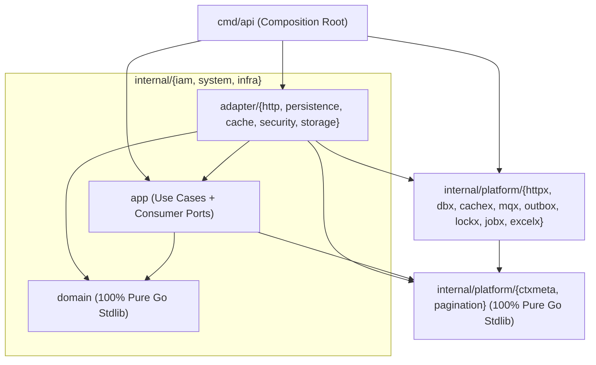

# OWOT-Pro 工程架构与目录结构规范

> 遵循《Go 项目工程目录结构设计规范 1.2》，以**单 Go Module 模块化单体（Modular Monolith）**为基线。

## 一、强制项与推荐项界定

| 类别 | 条款 | 说明 |
| :--- | :--- | :--- |
| **强制项（Mandatory）** | 1. 单 `go.mod` 模块化单体起步，所有代码归入 `internal/` 与 `cmd/`，依赖随真实代码按需引入<br>2. 按业务领域（`iam` / `system` / `infra`）组织代码，禁止顶层按 `controller/service/dao` 分包<br>3. 严格依赖方向：`cmd → adapter → app → domain`；**`domain` 100% 仅依赖 Go 标准库**；**`app` 仅依赖本领域 `domain`、标准库及纯标准库平台契约包（`ctxmeta`、`pagination`），严禁直接或间接依赖 Gin/GORM/Redis/MQ SDK**<br>4. 接口由消费方定义（Consumer-Defined Interfaces），禁止集中式胖接口层<br>5. 严禁 `common` / `utils` / `shared` 大杂烩目录<br>6. 严禁预建无代码的空壳目录；依赖在 `cmd/api` 中显式手动组装 | 架构红线，通过 `cmd/api/arch_test.go`（AST Import 依赖树检查）与 `.golangci.yml` 自动强制执行 |
| **推荐项（Recommended）** | 1. 领域内部是否完整拆分为 `domain` / `app` / `adapter`<br>2. Adapter 子目录按技术协议拆分粒度 | `iam` 领域规则复杂，采用完整三层；`system` 领域以 CRUD 为主，采用精简结构 |

---

## 二、工程目录结构

### 2.1 Phase 01 最小工程骨架（当前已落地并可校验）

```text
owot-pro/
├── AGENTS.md                          # AI 工程入口与全局约束
├── README.md                          # 项目说明与快速启动指南
├── go.mod                             # 单 Go Module（零冗余依赖）
├── Makefile                           # 统一 fmt / vet / test / race / lint / build / check / test-integration
├── .golangci.yml                      # 静态检查配置
├── .github/workflows/ci.yml           # CI 流水线（Unit + Lint + MySQL/Redis Integration）
├── cmd/
│   └── api/
│       ├── main.go                    # 启动入口、信号处理与优雅退出骨架
│       └── arch_test.go               # 架构依赖边界 AST 自动守卫测试
├── internal/
│   ├── iam/AGENTS.md                  # iam 领域局部规则
│   ├── system/AGENTS.md               # system 领域局部规则
│   └── infra/AGENTS.md                # infra 领域局部规则
└── docs/                              # 完整架构、领域、数据库与测试规范文档
```

### 2.2 业务模块演进后的目标目录形态（按需随代码创建，不预建空目录）

```text
owot-pro/
├── cmd/
│   └── api/
│       ├── main.go                    # 进程入口：加载配置、信号监听、优雅退出
│       ├── server.go                  # Composition Root：初始化 Infrastructure、显式组装各领域 UseCase 与 Adapter
│       └── arch_test.go               # 架构守卫测试
├── internal/
│   ├── iam/                           # [领域 1] 身份认证、用户、组织、RBAC 权限、SaaS 多租户（复杂领域：三层结构）
│   │   ├── AGENTS.md
│   │   ├── domain/                    # 纯 Go 实体、值对象、领域服务与业务不变量（100% 仅依赖标准库）
│   │   │   ├── user.go                # AdminUser 实体、密码明文强度规则、状态流转
│   │   │   ├── dept.go                # Dept 实体、部门树构建、防环校验、子孙展开算法
│   │   │   ├── post.go                # Post 岗位实体
│   │   │   ├── role.go                # Role 实体、内置角色保护（super_admin / tenant_admin）、5 级 DataScope
│   │   │   ├── menu.go                # Menu 实体、目录/菜单/按钮层级校验
│   │   │   ├── permission.go          # 权限计算纯函数、租户套餐变更角色菜单回收计算
│   │   │   ├── tenant.go              # Tenant 与 TenantPackage 实体、配额与过期校验
│   │   │   ├── token.go               # OAuth2Client、AccessToken、RefreshToken 实体与过期计算
│   │   │   └── errors.go              # 纯标准库领域哨兵错误（errors.New）与 DomainError
│   │   ├── app/                       # 用例编排层 + 消费方接口（仅依赖 domain、标准库、platform/ctxmeta、platform/pagination）
│   │   │   ├── ports.go               # 定义 Repository、PasswordHasher、TokenStore、OutboxPublisher 等消费方接口
│   │   │   ├── auth_service.go        # 登录、登出、续期、获取当前用户菜单权限树用例
│   │   │   ├── user_service.go        # 用户 CRUD、配额检查、重置密码、个人中心、导入导出用例
│   │   │   ├── dept_post_service.go   # 部门树与岗位管理用例
│   │   │   ├── permission_service.go  # 角色/菜单管理、赋权、权限版本推进与校验用例
│   │   │   ├── tenant_service.go      # 租户创建（级联初始化默认部门/角色/管理员）、套餐变更同步用例
│   │   │   └── oauth2_service.go      # OAuth2 客户端管理、Token 签发/校验/强退用例
│   │   └── adapter/                   # 外部协议与技术实现适配层
│   │       ├── http/                  # Gin HTTP Handlers + 领域错误码映射（1_002_xxx_xxx）
│   │       ├── persistence/           # GORM 仓储实现 + Outbox 同事务写入
│   │       ├── cache/                 # Redis AccessToken + 租户权限版本号 + Ristretto 本地二级缓存适配
│   │       └── security/              # PasswordHasher 的 golang.org/x/crypto/bcrypt 适配实现
│   │
│   ├── system/                        # [领域 2] 系统通用支撑：字典、通知公告、操作与登录日志
│   │   ├── AGENTS.md
│   │   ├── domain/                    # DictType/DictData、Notice、OperateLog、LoginLog 纯标准库实体与领域错误
│   │   ├── app/                       # 字典服务、公告服务、审计日志服务 + ports.go
│   │   └── adapter/
│   │       ├── http/                  # Gin HTTP Handlers + 错误码映射
│   │       └── persistence/           # GORM 仓储实现
│   │
│   ├── infra/                         # [领域 3] 基础设施与运维中枢：配置、文件、定时任务、API 日志、Redis 监控
│   │   ├── AGENTS.md
│   │   ├── domain/                    # Config、FileConfig/FileObject（含路径防穿越纯函数）、Job/JobLog、ApiLog 纯标准库实体
│   │   ├── app/                       # 参数配置、文件服务、任务调度管理、API 日志、Redis 监控用例 + ports.go
│   │   └── adapter/
│   │       ├── http/                  # Gin HTTP Handlers + 错误码映射
│   │       ├── persistence/           # GORM 仓储实现
│   │       └── storage/               # FileStorageEngine 端口的 Local / DB / S3(MinIO) 多引擎适配器与动态工厂
│   │
│   └── platform/                      # [内部技术平台] 严格区分“纯标准库契约包”与“框架基础设施包”
│       ├── ctxmeta/                   # [纯标准库] LoginUser、TenantID、TraceID、DataScope 的 Context 存取与克隆
│       ├── pagination/                # [纯标准库] PageQuery 与 PageResult[T] 泛型分页结构
│       ├── apperr/                    # [纯标准库] HTTP/RPC 协议层 ErrorCode 与 AppError 映射工具
│       ├── timeutil/                  # [纯标准库] 毫秒时间戳 JSON 序列化与时间区间解析
│       ├── config/                    # [基础设施] YAML + ${ENV:default} 配置加载器
│       ├── observability/             # [基础设施] Zap 结构化日志、Prometheus 指标
│       ├── httpx/                     # [基础设施] Gin 封装、统一响应 {code,data,msg}、认证/租户/权限/审计/幂等/限流中间件
│       ├── dbx/                       # [基础设施] GORM 连接池、BasePO/TenantBasePO、多租户与数据权限 GORM 插件、TxManager
│       ├── cachex/                    # [基础设施] Redis 客户端、泛型 RedisStore[T]、Ristretto 本地缓存
│       ├── mqx/                       # [基础设施] 消息总线（Memory / Redis PubSub 广播 / Redis Stream 消费组）
│       ├── outbox/                    # [基础设施] 事务性 Outbox 表写入器与后台 Relay 轮询重放补偿器
│       ├── lockx/                     # [基础设施] Redis Lua 分布式锁实现
│       ├── jobx/                      # [基础设施] robfig/cron 集群定时任务调度器
│       ├── excelx/                    # [基础设施] Excelize 结构体标签导入导出器
│       └── testhelper/                # [测试支撑] SQLite/miniredis 快速容器与真实 MySQL/Redis 集成测试套件
└── tests/
    ├── integration/                   # 针对真实 MySQL / Redis 的仓储、事务、Outbox 与分布式锁集成测试
    └── e2e/                           # 跨领域端到端验收测试
```

---

## 三、核心目录职责与依赖边界铁律

| 层级 / 目录 | 允许导入（Imports Allowed） | 绝对禁止导入（Imports Forbidden） |
| :--- | :--- | :--- |
| **`internal/<domain>/domain`** | **仅限 Go 标准库**（`context`, `time`, `errors`, `fmt`, `strings`, `slices` 等） | 严禁导入任何第三方包（含 `bcrypt`, `uuid`, `gorm`, `gin`）及任何 `internal/*` 包 |
| **`internal/<domain>/app`** | Go 标准库、同领域的 `domain`、`internal/platform/ctxmeta`、`internal/platform/pagination` | **严禁直接或间接导入 `gin`、`gorm`、`redis`、`cron`、`excelize` 或 `internal/platform/{httpx,dbx,cachex,mqx,lockx,jobx,excelx}`** |
| **`internal/<domain>/adapter/*`** | Go 标准库、同领域的 `app` 与 `domain`、`internal/platform/*`、对应的外部 SDK | 严禁不同 `adapter` 子包之间互相引用（如 `adapter/http` 不得导入 `adapter/persistence`）；严禁将 GORM PO 暴露出包外 |
| **`internal/platform/ctxmeta` & `pagination`** | **仅限 Go 标准库** | 严禁导入任何第三方库或任何其他 `internal/*` 包 |
| **`internal/platform/*`（其余包）** | Go 标准库、`internal/platform/*`、对应的基础设施 SDK | **严禁导入 `internal/iam`、`internal/system`、`internal/infra`** |

---

## 四、依赖方向与消费方接口设计

### 4.1 依赖流向图（零框架泄露到 `app` 与 `domain`）



### 4.2 消费方定义接口示例

1. **密码哈希能力（隔离 `bcrypt` 出领域层）**
   - 消费方 `internal/iam/app/ports.go` 定义：
     ```go
     type PasswordHasher interface {
         Hash(plain string) (string, error)
         Compare(hashed, plain string) error
     }
     ```
   - 实现方 `internal/iam/adapter/security/bcrypt_hasher.go` 封装 `golang.org/x/crypto/bcrypt`。
2. **事务控制能力（隔离 `gorm.DB` 出用例层）**
   - 消费方 `internal/iam/app/ports.go` 定义：
     ```go
     type TxRunner interface {
         WithinTx(ctx context.Context, fn func(ctx context.Context) error) error
     }
     ```
   - 实现方 `internal/platform/dbx.TxManager` 实现该签名。

---

## 五、跨领域协作与缓存失效恢复机制（对齐规范 1.2 §07）

针对权限变更、角色菜单回收、租户状态变更、文件主配置切换等需要跨实例同步的场景，若仅使用“事务提交后内存/PubSub 广播”，在**提交后进程崩溃、发布网络抖动或消费者断线重连**时会导致旧权限缓存无法失效。因此采用 **Transactional Outbox + 权限版本号（Epoch）+ 本地缓存有界短 TTL** 方案：

| 机制层级 | 设计细节 | 故障恢复效果 |
| :--- | :--- | :--- |
| **1. 同事务 Outbox 持久化（`sys_outbox_event`）** | 当 `iam` 修改角色权限、用户角色、部门树、租户状态/套餐，或 `infra` 切换 Master 文件配置时，在**同一个数据库事务**中写入一条 `sys_outbox_event`（状态 `PENDING`）。 | 即使事务提交后瞬间进程 OOM 或断电，事件已持久化在数据库中，绝不丢失。 |
| **2. Outbox Relay 轮询投递 + Pub/Sub 加速** | 事务提交后立即尝试一次非阻塞 Redis Pub/Sub 广播并标记 `PUBLISHED`；同时后台 `outbox.Relay` 每 `2s`（分布式锁保护）扫描未发布的 `PENDING` 事件重放广播并递增 Redis 中的租户权限版本号 `iam:perm_ver:{tenantId}`。 | 正常情况下 `< 100ms` 全集群感知；发布失败时在 `≤ 2s` 内由 Relay 自动重放补偿。 |
| **3. 租户权限版本号校验 + 本地有界 TTL（30s）** | 各节点本地 Ristretto 缓存条目同时携带 `ver` 与 `30s` 硬过期时间；每次权限校验先比对轻量级版本号，一旦断线重连或错过 Pub/Sub 广播，最多 `30s` 后本地缓存自然过期并回源加载最新权限。 | 杜绝“断线期间错失广播导致永久残留旧权限”；AccessToken 强退直接查询/删除 Redis 权威 Key，**0ms 立即生效**。 |
